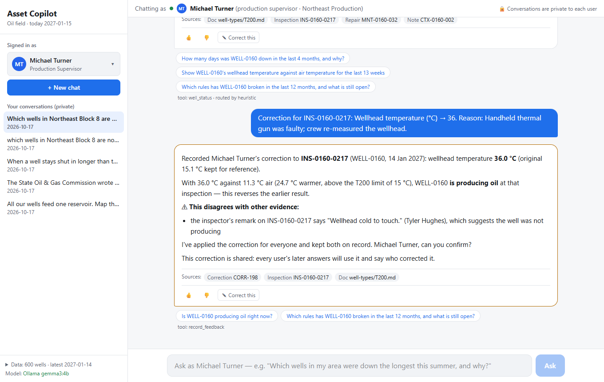
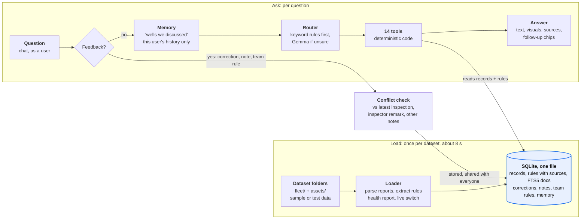

# Asset Intelligence Copilot

A chat copilot for the FlytBase Hack Day oil-field challenge. Operators ask plain-English questions about their wells and get an answer with evidence and the right inline visual: a status card, table, line chart, bar chart, map or heatmap. It remembers what people tell it, applies corrections for everyone, and points out conflicts instead of picking a side.

## Quick start

Requirements: Node 20+, and optionally [Ollama](https://ollama.com) with a Gemma model or a free Gemini key. SQLite is built in; there is no database server to install.

```bash
npm install
npm run ingest -- ../flytbase-ahc-swe-asset-intelligence-dataset/sample-data
npm run dev            # http://localhost:3000
```

**Test dataset.** The test data released for the final questions already contains all 200 sample wells (with newer records), so load it **on its own**:

```bash
npm run ingest -- ../flytbase-ahc-swe-asset-intelligence-dataset/test-data/dataset --today 2027-01-15 --fresh-memory
```

You can also pass several folders to load them together, e.g. a sample plus a separate set of extra wells.

Each load builds a new database file (`data/copilot-<time>.db`) and then switches `data/active.json` to it. **A running server picks up the new data within a second, with no restart and no failed requests** (tested: 22 questions during two live reloads, 0 failures). Corrections, shared notes, team rules and conversations are carried over unless you pass `--fresh-memory`. The loader ends with a health report: **errors** mean answers could be wrong (e.g. a manual's producing rule couldn't be read) and the exit code is 2; **warnings** need a look. The same report is in the app's sidebar under "Data".

## When the test dataset arrives (runbook)

1. Get it: `git pull` in the dataset repo. The data is in `test-data/dataset/` (with `fleet/` and `assets/`), and the questions are in `test-data/final-questions.md`.
2. Integrity check, about 30 s: `python -I tools/ground_truth_review.py ../flytbase-ahc-swe-asset-intelligence-dataset/test-data/dataset --today 2027-01-15`.
3. Set `COPILOT_TODAY` in `.env.local` to the date the final questions call "today" (**2027-01-15** for this test set). The app reloads `.env.local` by itself.
4. Load: `npm run ingest -- ../flytbase-ahc-swe-asset-intelligence-dataset/test-data/dataset --today 2027-01-15 --fresh-memory`.
   - **No errors** → go on.
   - **Error about a well type's producing rule** → read that manual's rule, then either fix the wording pattern in `lib/rules-extract.ts` and reload, or tell the copilot in chat, e.g. "Note for all T500 wells: a well is producing at 18 °C above air".
5. Smoke test, about 2 s: `npm run smoke`. It picks real wells, areas and spills from the loaded data and asks one question per tool.
6. Ask the final questions in the UI as the named users, and copy the answers and visuals into the results page.

To demo a live reload, keep the app open and run step 4. The sidebar's "Data" line changes to the new well count within about 5 seconds.

Model settings are in `.env.local` (see `.env.example`). The default is local Gemma (`gemma3:4b`) through Ollama. `LLM_PROVIDER=none` runs on keyword routing alone.

**Set "today".** `COPILOT_TODAY` in `.env.local` is the date used for "right now", "last 90 days" and deadlines. Set it to the date the question document states: **2027-01-15** for the test data, 2026-10-17 for the example scenarios on the sample. The running app picks up the change by itself. If it is unset, the copilot uses the day after the latest inspection.

**The `data/` folder** (never committed) holds `active.json`, which points at the live database `copilot-<time>.db`. Older `copilot-*.db` builds and the `eval.db` / `smoke.db` scratch copies can be deleted anytime. In development, the server can keep an old build open after code edits; if a delete fails, stop `npm run dev`, delete, and start it again.

| Command | What it does |
|---|---|
| `npm run eval` | Runs the 18 example scenarios end to end (multi-user, memory, feedback) on a scratch copy of the database |
| `npm run eval -- --router llm` | Same, with the model doing all routing |
| `npm run probe` | Unseen questions in new phrasings |
| `npm run ask -- U-201 "question"` | One question from the command line |
| `npm run smoke` | One question per tool against whatever data is loaded (works on any dataset) |
| `npm run reset-memory` | Clears conversations and everything users taught the copilot |
| `python -I tools/ground_truth_review.py <dataset> [--today D]` | Independent integrity check of any dataset |
| `python -I tools/ground_truth_answers.py <dataset> [--today D]` | Independent Python recomputation of the sample's expected answers |

## See it in action

One scenario on the test data, step by step with screenshots: [images/README.md](images/README.md). It covers wells not producing, a map view, sources, a correction with a conflict warning, shared and private memory, and a 7-area spill heatmap.



## How it works

**Numbers come from code over one SQLite file; the model only routes.**



1. **Load.** The loader reads one or more dataset folders into a new SQLite file, then the running app switches to it.
2. **Feedback** (a correction, a shared note, a team rule) is checked against the data and other people's notes before it is stored. Conflicts are shown, never hidden.
3. **Memory.** "The wells we discussed" is answered from that user's own conversations only.
4. **Router.** Picks one of 14 tools and its arguments: keyword rules when they are sure, otherwise the local Gemma model. Model arguments are validated, and values found in the question's text win.
5. **Tools** compute the answer from SQLite, with corrections, team rules and manual rules applied. The model writes text only for open questions over documents.

**Data.** `scripts/ingest.ts` loads every file into SQLite (`data/copilot-<time>.db`). It parses the free-text repair reports (containment time, compliance-check table, spill class), splits manuals and SOPs into sections with full-text search (FTS5), and **extracts the numeric rules** from the manuals and SOPs: producing threshold per well type, spill classes, deadlines, RCA trigger. Each rule keeps its document and section for citations. Nothing is hard-coded from the sample questions.

The loader also stores the fields that are new in the test data. None of them are required, so the sample still loads unchanged:

| New in the test data | Stored as |
|---|---|
| `well_type` T500 (`fleet/well-types/T500.md`) | Its producing rule (25 °C) is read from the manual like the others |
| `status` = `plugged_and_abandoned`, `decommissioned_on` | `wells.status`, `wells.decommissioned_on` |
| `type_history`, `team_history` | `wells.type_history`, `wells.team_history` (JSON) |
| `recorded_at` (late-entered records, IDs ending `-B…` / `-L…`) | `inspections.recorded_at`, `maintenance.recorded_at` |
| `cost_revision` | `maintenance.cost_revision` (JSON); `cost_usd` already holds the revised amounts |
| `note_type` = `data_correction` (field, original, corrected value) | `notes.field / original_value / corrected_value`, and **applied** as a correction everywhere, with the original kept |
| Report lines `**Parts installed:**` and `**Follow-up:**` | `reports.parts_model / parts_serial / parts_lot`, `reports.followup_days / followup_text` |
| New documents in `fleet/sops/` (operations SOP rev 2, recall notice, MOC memos, regulator letter) | Loaded and searchable section by section |

**Effective data.** Every tool reads inspections through one layer (`lib/domain.ts`). That layer applies corrections (keeping the original value), evaluates "producing" against the well type's rule, and resolves rules in the order *override for this well → override for its type → manual*. A correction or team rule therefore changes every later answer, for every user, at exactly its scope.

**Tools** (`lib/tools.ts`): well status, wells not producing, temperature series, spills, spill heatmap, downtime, compliance audit (SR-01–04, RC-01–04, RCA, shut-in recording, report "Not met" items), RCA candidates, repairs and costs, regulator events, well details, spill rules by size, document search, and read-only SQL as a last resort. Each returns a correct draft answer, the visual data and citations.

**Model use.** The model never computes numbers. It (1) picks a tool and arguments when the keyword router isn't sure, (2) extracts feedback the parser can't, and (3) writes answers to open questions over document sections. Model arguments are validated, and values found in the question text (wells, area, period) win over the model's.

**Memory.**
- *Shared:* corrections, shared notes (planned downtime) and team rules are stored once and used in every user's answers, with who said it.
- *Private:* each user's conversations, and the wells each answer was about, are stored per user. "The three wells we discussed yesterday" looks only at that user's history and never substitutes a different set.

**In the chat UI.**
- *Switch the view:* every answer carries all the visuals its data supports (e.g. Table | Map, or Bar chart | Table). The buttons switch on the spot, with no new request and no model call.
- *Map clustering:* nearby pins merge into a bubble showing how many wells it holds (red if any of them needs attention). Clicking a bubble zooms in until the wells separate; bubbles at a single location list their items. Small maps (e.g. 4 wells) still show plain labelled pins.
- *Follow-up chips:* 2–3 suggested next questions, built from the answer's tool, arguments and wells. Wells are named explicitly, so a chip means the same thing whenever it is clicked. `npm run check-followups` asks every generated chip.
- *👍 / 👎:* stored per answer (`answer_ratings`); 👎 asks what was wrong.
- *Correct this:* a form to pick an inspection (prefilled from the answer's sources, current values shown), the field (wellhead or air temperature as raw data; spill volume or "not a real spill" as AI analysis), the new value and a reason. It goes through the same correction path and conflict checks as a correction typed in chat.

**Conflicts.** Before storing a claim, the copilot compares it with the latest inspection, the inspector's remark and other notes (including the author's own). A raw-data correction is applied but its conflicts are shown. A status claim that contradicts the data is stored as *unconfirmed* and the user is asked to confirm.

## Status on the test data (15 Jan 2027)

- Loads 600 wells, 125,198 inspections, 17,415 repairs, 4,437 reports, 328 regulator events and 1,887 notes in about 8 s, with no errors. All three producing rules are read from the manuals (T200 15 °C, T350 20 °C, T500 25 °C). `npm run smoke` passes 17/17.
- **Stored but not yet used in answers:**
  - status from operator notes (operations SOP OPS-3: the most recent of inspection and operator note decides);
  - well type at the date of each reading (`type_history`);
  - excluding plugged wells from "not producing";
  - recalled pump lots versus installed pumps;
  - bypass approvals (MOC memos);
  - the regulator letter's scope;
  - follow-up deadlines;
  - reasons for waiting.

  These are what most of `test-data/final-questions.md` asks about. Today, such questions fall back to document search.

## Results on the sample

- `npm run eval`: 26/26 checks across the 18 scenarios, about 1 s (hybrid routing). The eval's expected answers are for the **sample** data, so load the sample before running it (it then runs on a scratch copy).
- `--router llm` with local `gemma3:4b`: 25/26. The model sent "not contained within the time limit" to the spill list instead of the compliance check; hybrid routing handles it.
- Local Gemma on CPU takes roughly 10–60 s per model call. Questions the keyword router recognises answer in milliseconds.
