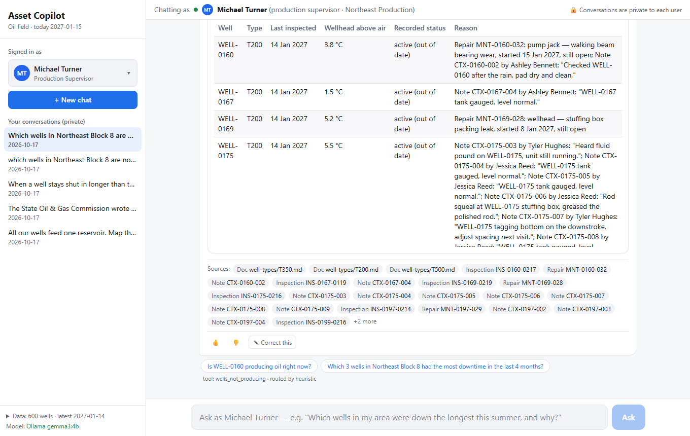
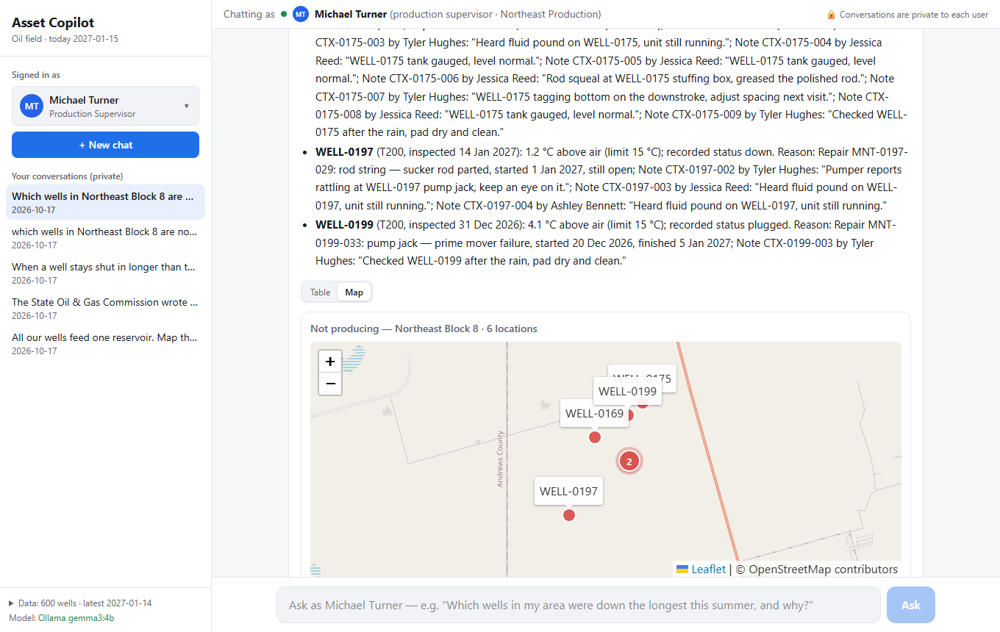
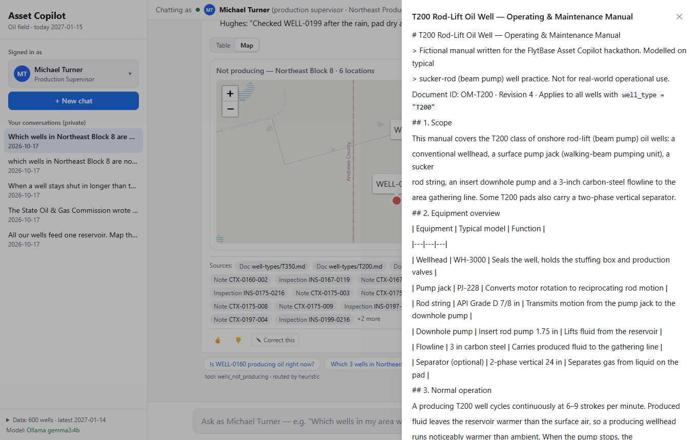
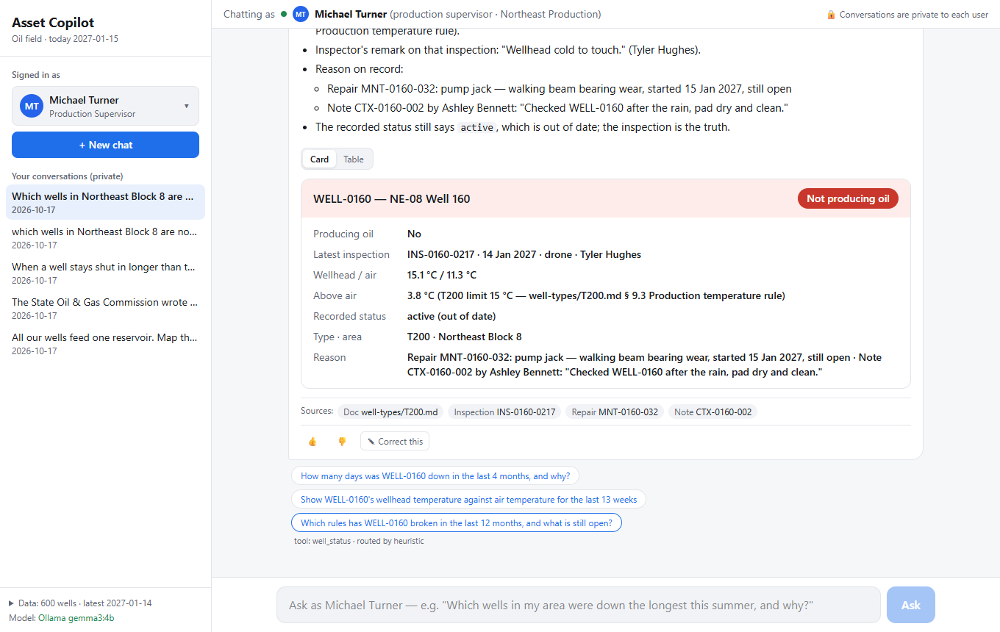
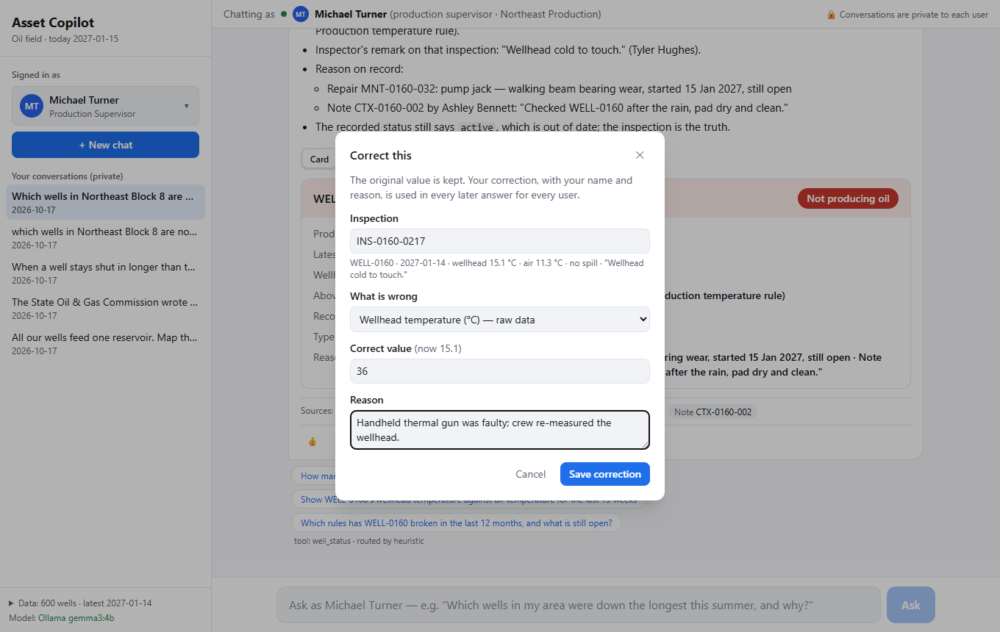
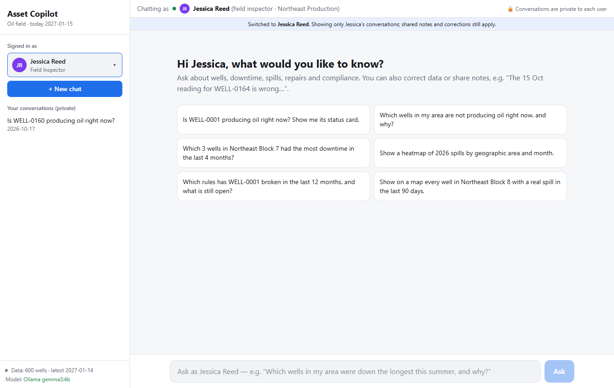
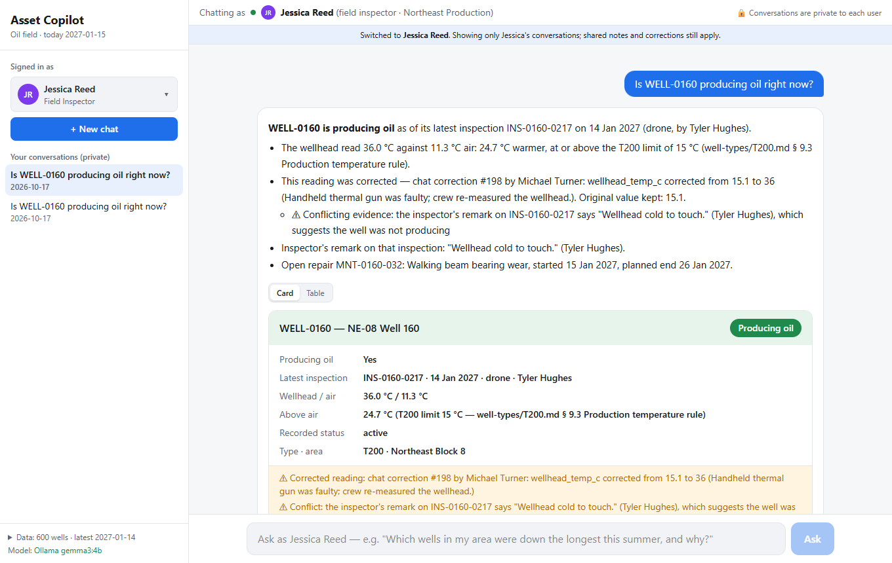
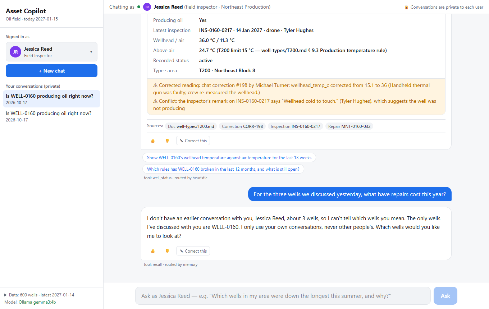
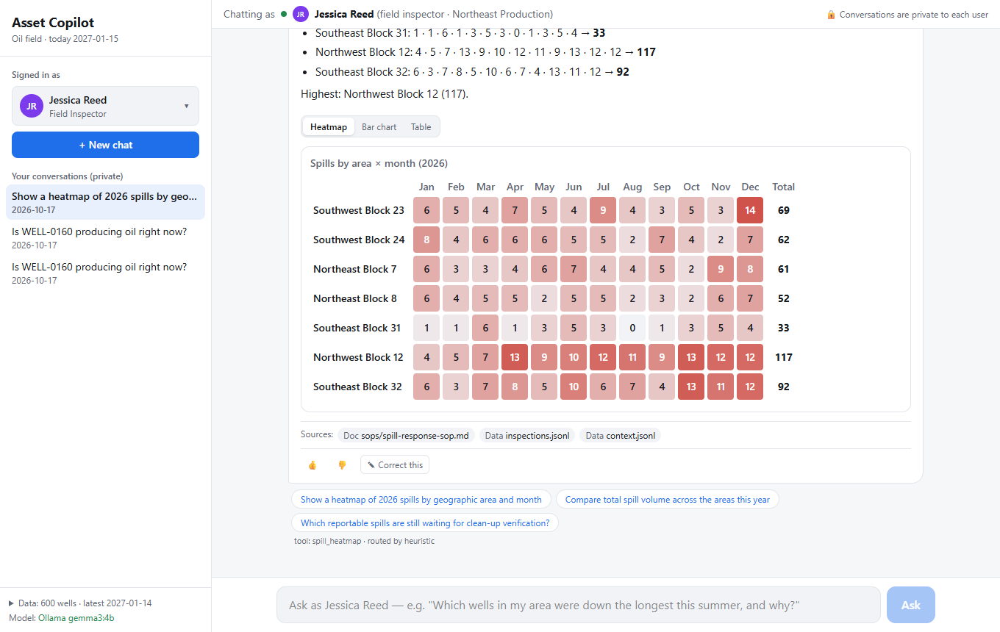

# One scenario, end to end

Screenshots of the copilot on the **test dataset** (600 wells, 7 areas, today = 15 Jan 2027). Two people take part: **Michael Turner**, production supervisor, and **Jessica Reed**, field inspector, both in Northeast Production. Every number comes from code over the database; the screenshots were taken from the running app.

## 1. Which wells are not producing oil, and why?

Michael asks: *"Which wells in Northeast Block 8 are not producing oil right now, and why? Show them in a table."*

6 wells are not producing at their latest inspection on 14 Jan 2027. For each one the answer shows how much warmer the wellhead is than the air (the T200 limit is 15 °C), and the reason on record: an open repair, a note, or none. It also marks the recorded status "active" as out of date, because the inspection is the truth. The sources and two suggested follow-up questions are under the answer.

## 2. The same answer as a map

The **Map** button switches the same data to a map. There is no new question and no model call.

## 3. Every answer shows its sources

Clicking a source chip opens the record or document it came from. Here it is the T200 manual, with the production temperature rule the answer applied.

## 4. Follow-up: one well's status card

The follow-up chip asks *"Is WELL-0160 producing oil right now?"* No: the wellhead is only 3.8 °C above the air. The inspector, Tyler Hughes, noted "Wellhead cold to touch.", and repair MNT-0160-032 (walking beam bearing wear) is open.

## 5. Correcting the data

The field crew says the reading was wrong. Michael uses **Correct this**:
- **Inspection:** INS-0160-0217, with its current values shown.
- **What is wrong:** the wellhead temperature.
- **Correct value:** 36 °C.
- **Reason:** "Handheld thermal gun was faulty; crew re-measured the wellhead."

## 6. The correction is recorded, and the conflict is shown

The copilot records the correction and keeps the original 15.1 °C. At 36 °C, 24.7 °C above the air, WELL-0160 now counts as producing. But it also warns that the inspector's remark "Wellhead cold to touch." disagrees, and asks Michael to confirm. It doesn't hide the conflict.

## 7. Another person, private conversations

Switching to Jessica Reed shows only her own conversations. Michael's chat is private.

## 8. The correction reaches everyone

Jessica asks about WELL-0160. She sees **producing oil**, based on the corrected reading, with who corrected it and why, and the inspector's conflicting remark. Corrections are shared with every user.

## 9. Private memory

Jessica asks about *"the three wells we discussed yesterday"*. The copilot says it has no such conversation with her. It never uses Michael's history.

## 10. Field-wide view: spills by area and month

*"Show a heatmap of 2026 spills by geographic area and month."* All 7 areas, with corrected detections removed. Northwest Block 12 has the most spills, 117 in 2026. The same answer can also be shown as a bar chart or a table.

---

The screenshots were taken in the running app. The demo correction and conversations were removed from the data afterwards.
